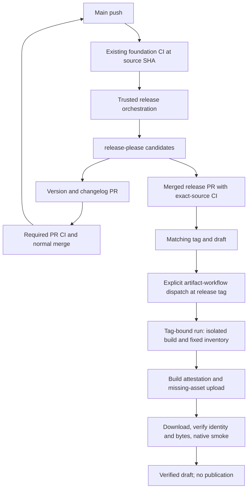
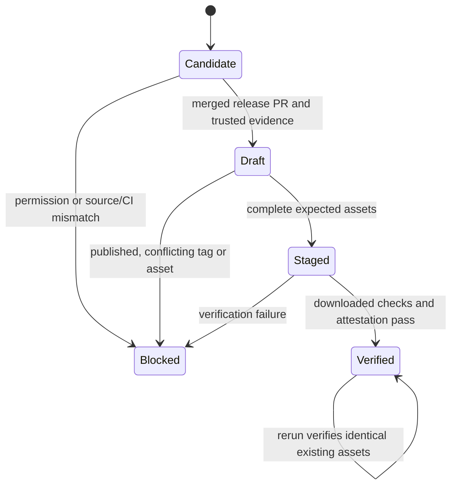

# Router Release Automation - Plan

## Goal Capsule

- **Objective:** Maintainers receive automatically calculated release PRs and can inspect verified Linux binaries in a draft before any public release.
- **Means:** A pinned release-please engine and the existing native builder, joined by trusted CI orchestration (KTD1–KTD5).
- **Authority:** The operator approved implementation on 2026-10-19. Requirements below govern scope; technical decisions govern mechanisms; units change neither.
- **Execution:** Three dependency-ordered units, each implemented by a fresh worker. The parent owns integration, verification, the ready PR, one CI-sensitive Pro review, merge, and closeout.
- **Stop conditions:** Never change account permissions, create a real acceptance-test release/tag, publish publicly, or bypass a failed trust check. A source implementation may proceed while activation is blocked; do not describe it as operating automation.
- **Tracking:** [Issue #553](https://github.com/StartupBros/wstack-router/issues/553), kept open pending operator confirmation.

---

## Product Contract

### Summary

Install automatic release PR generation and a draft-only Linux x86_64 artifact pipeline. Reuse existing build and smoke-check machinery. Preserve the independent source identity and legacy installation contracts.

### Problem Frame

The inherited manual release path pushes a version commit directly to main, publishes npm, and fans out to other publishers. Its binary workflow exposes a release before uploading assets and can replace existing bytes. That ordering cannot safely stage the first independent Router release.

### Key Decisions

- **Independent identity with compatible distribution surfaces.** Governs R5. (session-settled: user-directed — chosen over replacing the router or globally renaming its operational namespaces: the existing fork already serves the operator's needs.)
- **Release PRs and verified drafts first.** Governs R1–R4 and R6. (session-settled: user-approved — chosen over a combined release/updater/announcement rollout: publication and installation require separate authority.)

### Requirements

**Versioning**

- R1. A maintained engine calculates one product SemVer and changelog from changes since an explicit baseline; root package, CLI package, release manifest, and Bun workspace version remain synchronized.
- R2. Preserve existing commit-prefix intent, including feature aliases and breaking changes; cosmetic-only changes generate no release PR. Retain the 3.5.78 lineage without a manual version bump.

**Draft artifacts**

- R3. Only a merged release PR with successful CI at its exact source commit can authorize a stable tagged draft build. The implementation merge must not create a release or tag.
- R4. A ready draft contains exactly the declared native binary, checksums, and release manifest, with verified build attestation and a fresh download checked against independently expected repository, workflow, tag, commit, version, size, and digest. Any mismatch fails visibly.

**Compatibility and authority**

- R5. Keep upstream publication behavior outside StartupBros/wstack-router, local unpublished preparation, package and command names, storage/config namespaces, and attribution unchanged. Router's inherited publishing and signing jobs must not run through any of their triggers.
- R6. This increment never publicly publishes, announces, installs, restarts services, deploys, changes account permissions, or uses provider inference. Published releases and their assets are never deleted or overwritten; reruns verify existing bytes rather than clobbering them.

### Scope Boundaries

No npm/GHCR rollout, Windows/macOS release matrix, preview channel, updater, service transaction, HoV/wstack source edits, or TUF deployment. These are not prerequisites for this draft-only increment.

No new public CLI flag solely for build verification: existing version/SHA exits and compiled provenance fixtures cover the available surface. A fixture is not full introspection of the shipped executable.

### Activation Dependency

The repository currently reports `default_workflow_permissions: read` and `can_approve_pull_request_reviews: false`. The latter blocks built-in-token release PR creation. The only referenced alternative credential, `RELEASE_PAT`, returned HTTP 404 on a metadata lookup and is not an established fallback. Leave these settings and credentials unchanged. Surface the exact permission blocker in operational documentation and tracking; implementation and local verification do not depend on changing it.

GitHub immutable releases are currently disabled. The pipeline must enforce its own no-clobber contract, but must not claim platform-enforced immutability. Enabling that account feature is separately reserved.

---

## Planning Contract

### Key Technical Decisions

- KTD1. **Use release-please 17.11.2 as a pinned development/build dependency through its supported library interfaces.** The latest action v5.0.0 bundles engine 17.6.0; using the engine directly avoids assuming newer draft/tag support exists in that action. Retain maintained SemVer/changelog/PR machinery rather than writing another version calculator. A thin extension may normalize existing commit aliases and update the Bun workspace field; executable fixtures must demonstrate both behaviors.
- KTD2. **One root manifest release, stable tags, explicit bootstrap.** Seed the release manifest at 3.5.78 and bootstrap after d981843f014e76d8d1743410010d3628bbdc3962. Use the node strategy, a CLI JSON extra-file update, component-free vX.Y.Z tags, draft releases, and explicit tag creation. Do not leave a persistent last-release override. Keep implementation housekeeping non-releasable; PR creation alone is not a tag/release signal.
- KTD3. **Use an exact-tag dispatch for build and attestation.** A serialized coordinator follows successful foundation CI for a main push. Release PR reconciliation requires current main; pending releases and explicit draft retries may use an ancestor only with successful foundation push CI at that exact source SHA. Check candidates before writes. After validating the draft/tag, dispatch a separate artifact workflow at that tag using GitHub's token-supported dispatch exception. Its workflow version must exist both on main and at the tag. Revalidate inputs, merged PR, tag, source ancestry and exact-source CI in the dispatched run; require its `github.sha` and `github.ref` to match the release identity. This is necessary because attestation certificates use the run's OIDC commit/ref, not checkout HEAD. Keep coordinator and artifact concurrency groups separate, with cancellation disabled. Ordinary PR validation remains read-only; do not bypass approval-gated PR CI or install a new identity.
- KTD4. **Keep local and release preparation entrypoints separate.** Factor only common build/staging/smoke operations from `prepare-router-artifacts.ts`. The local caller retains its two-file output and environment allowlist. The release caller validates explicit expected version/ref/SHA against the existing clean-tree, exact-origin, exact-tag evidence before building with the branded producer. Missing evidence is an error only on the trusted path; ordinary unproven builds stay supported.
- KTD5. **Use a small, fixed release inventory.** The release output adds `release-manifest.json` to `better-ccflare-linux-amd64` and `SHA256SUMS`. It records schema, repository, version, source commit/ref, Bun pin, target, binary name/size/digest and expected branded provenance. The manifest is a claim, not its own trust anchor. GitHub's attestation service supplies provenance for the binary and manifest without adding an unspecified release asset. Verify downloaded bytes with the GitHub CLI against expected signer workflow/repository/source identity before executing smoke checks.
- KTD6. **Reruns reconcile, never replace.** Resolve the draft by release ID/tag and re-read draft status before uploads. Upload only missing expected assets. If an existing asset differs, the release is published, the tag moved, or metadata disagrees, stop with the offending identity; never delete, clobber, or silently rebuild an existing attested asset. Reuse verified staging outputs where supported; a rerun that produces different bytes must stop rather than replace them.
- KTD7. **Exclude only Router from inherited publishers.** Add an exact repository exclusion to the manual npm release, multi-architecture release, both SignPath workflows, and Docker jobs. Retain their triggers and other conditions elsewhere. Give Router a distinct workflow name and add side-effecting workflows to auto-rerun exclusions. This is an intentional Router-only compatibility change required by R5, not a restriction on other forks.

### High-Level Technical Design

### Implementation-Time Checks

Verify the exact pinned library APIs and Bun JSONC updater behavior during U1; dependency execution is not planning evidence. Keep adaptation to serialization and alias normalization, not replacement release logic. If the library cannot satisfy R1–R3 without a custom release framework, return the concrete incompatibility rather than broadening the design.

Existing `--version` and `--git-sha` verify the actual binary's public identity. The existing compiled-fixture pattern verifies the full branded tuple and non-actionability using the same defines. Report this distinction in release verification output.

---

## Implementation Units

### U1. Maintained version engine and release candidates

**Goal:** Produce correct release PR changes and draft candidates through the real pinned engine.

**Requirements:** R1, R2, R3, R6; KTD1–KTD3. **Dependencies:** None.

**Files:** `package.json`, `bun.lock`, `release-please-config.json`, `.release-please-manifest.json`, `scripts/router-release.ts`, `scripts/__tests__/router-release.test.ts`.

**Approach:**
1. Write executable engine fixtures before adapting the library.
2. Configure the root product and implement the smallest supported adapters for existing prefix normalization and the CLI workspace version in Bun's lockfile.
3. Separate read-only candidate generation from remote effects. Expose narrow commands for PR reconciliation and draft creation, with expected source identity supplied by trusted orchestration.
4. Validate candidate version, merged PR, tag target, main ancestry and source-CI evidence before effects. Emit explicit outputs for the tag-bound artifact dispatch.

**Test scenarios:**
- From 3.5.78, fix yields 3.5.79, feat/feature/add/new yield 3.6.0, and breaking changes yield 4.0.0.
- Existing fix/security/improvement aliases retain their documented intent; docs/chore/test/style-only history yields no release PR.
- Bootstrap excludes old history; implementation housekeeping creates neither release nor tag.
- Root, CLI, release manifest and Bun CLI workspace advance together without changing other workspace versions; frozen installation accepts the candidate lockfile.
- A merged release PR remains discoverable after another commit advances main; draft creation/retry validates ancestry and CI at the release commit. Unmerged, non-ancestor, wrong-version, wrong-repository or failed-CI candidates make no remote writes; stale PR reconciliation remains refused.
- Existing draft/tag is reconciled; published releases and conflicting tags fail closed. Transport fakes demonstrate call ordering, not live GitHub behavior.

**Verification:** Real engine-generated updates and version decisions pass fixtures; transport boundaries are explicitly labeled. No real remote release or tag is used for proof.

### U2. Trusted artifact preparation and verification

**Goal:** Build and verify a branded Linux release without weakening unpublished preparation.

**Requirements:** R3–R6; KTD4–KTD6. **Dependencies:** U1's identity/output contract.

**Files:** `apps/cli/prepare-router-artifacts.ts`, a small shared internal artifact module, `apps/cli/prepare-router-release.ts`, `apps/cli/__tests__/prepare-router-artifacts.test.ts`, `apps/cli/__tests__/prepare-router-release.test.ts`, and `apps/cli/__tests__/build-multi-arch.test.ts` if additional shared provenance coverage is needed.

**Approach:**
1. Preserve existing local behavior with characterization tests before extracting reusable operations.
2. Add strict release evidence preflight, a fixed manifest, and downloaded-directory verification against independent expected values.
3. Reuse isolated alias/help/version smoke checks and add actual binary SHA checks. Retain atomic destination ownership and prior-output recovery.
4. Keep token-bearing orchestration outside build and smoke subprocess environments.

**Test scenarios:**
- Missing producer evidence, dirty tree, wrong origin/tag/HEAD/version or invalid stable version fails before building.
- A real native tagged build in an independent disposable repository produces the fixed inventory and expected version/SHA; local fixture tags never touch the working repository's shared refs.
- Missing/extra files, symlinks, traversal names, size/digest/source mismatches and malformed manifest/checksums fail before executing downloaded bytes.
- Hostile inherited environment and dotenv locations do not influence the build or smoke result.
- Existing destination refusal and early/late-failure restoration remain intact; local preparation still emits exactly two files and no branded release evidence.
- Shared compiled fixtures assert the full branded tuple remains proven and non-actionable.

**Verification:** Native artifact rehearsal and both command aliases pass without provider calls or production data. Fixtures and actual asset checks are reported separately.

### U3. Trusted workflow integration and operator documentation

**Goal:** Connect U1/U2 to CI with draft-only effects and contain inherited publishers.

**Requirements:** R1–R6; KTD3, KTD5–KTD7. **Dependencies:** U1 and U2.

**Files:** `.github/workflows/router-release.yml`, `.github/workflows/router-release-artifacts.yml`, `.github/workflows/release-dispatch.yml`, `.github/workflows/release.yml`, `.github/workflows/signpath-release.yml`, `.github/workflows/signpath-test.yml`, `.github/workflows/docker-publish.yml`, `.github/workflows/auto-rerun-failed.yml`, `scripts/__tests__/router-release-workflow.test.ts`, `tests/bun-toolchain-pin.test.ts` when the workflow inventory changes, and `docs/wstack-router-releases.md`.

**Approach:**
1. Add trusted main-push foundation completion and bounded explicit retry handling, with exact-source checks and serialized publication effects.
2. Separate token permissions by job: PR reconciliation, credential-free native build, and attestation/draft staging. Pin third-party actions to verified stable commit IDs.
3. Verify exact remote asset inventory and attestation on fresh downloads, then emit the draft URL and verified source identity. Never mark an incomplete draft ready.
4. Add Router-only exclusions and auto-rerun containment while preserving non-Router behavior.
5. Document version policy, the current permission blocker, non-immutable platform state, exact rerun failure behavior and the separate public-publication decision.

**Test scenarios:**
- Router tag/manual/workflow-run triggers cannot run legacy npm, binary, Docker or signing jobs; non-Router conditions retain their prior behavior.
- Fork PR, failed CI, non-main source, substituted SHA/workflow, stale candidate or wrong repository cannot reach write/attest/upload steps.
- Bot event suppression cannot strand the build: coordinator explicitly dispatches the artifact workflow at the stable tag, not main with a tag input. Required PR CI is not bypassed; signer/source certificate identity must match the dispatched commit and ref.
- Workflow contains no publish, asset deletion/clobber, package/image publishing, provider request or credential-bearing build subprocess.
- Incomplete upload can resume by verifying existing identical assets and adding missing ones; conflicting or published state stops.
- Attestation verification binds expected source identity, not only the repository name, before downloaded binary execution.

**Verification:** Workflow tests cover evaluated guard behavior as well as static permissions. Actual PR CI validates the merged source path; live remote draft staging remains explicitly unexercised under R6's acceptance-test boundary.

---

## Verification Contract

Use the repository-pinned Bun and frozen dependency installation. Generate ignored workers only through the supported CLI build before suites that import them. Never read or edit the four excluded generated files or modify `apps/cli/README.md`.

Run unit-specific suites independently, then the complete test-file inventory in isolated processes to avoid existing Bun mock-module contamination. Run `bun run lint`, `bun run typecheck`, and `bun run format`; review formatting for unrelated changes. Typecheck excludes tests, so execute every affected test suite explicitly. CI must include disposable live PostgreSQL checks and native artifact preparation.

Inspect the final diff and fresh-main overlaps at the exact revision. Because CI files change, run one Pro review, fix its P0/P1 findings, and do not request a second review round. Green exact-head CI and the standing merge policy govern landing. Keep issue #553 open.

No live draft/tag, attestation, announcement, permission mutation or production operation is an acceptance shortcut. Record unexercised remote behavior and the activation blocker honestly.

---

## Definition of Done

- U1–U3 are implemented with real engine and native artifact proof, required local checks, and exact-head CI.
- Legacy Router publishers cannot be reached by the new release flow, and non-Router compatibility tests pass.
- The implementation PR is merged and closeout reports the actual checkout activation result; no first release/tag is created by that merge.
- Automation is not described as active while GitHub's PR-creation policy blocks it. Public publication remains reserved.
- No abandoned experiments, unrelated formatting or generated worker files remain in the diff.

## Appendix

Source baseline: d981843f014e76d8d1743410010d3628bbdc3962. Existing integration points: `apps/cli/build-provenance.ts`, `apps/cli/build-multi-arch.ts`, `apps/cli/prepare-router-artifacts.ts`, and the publishing workflows named in U3.

External references: [release-please 17.11.2](https://github.com/googleapis/release-please/releases/tag/v17.11.2), [manifest configuration](https://github.com/googleapis/release-please/blob/v17.11.2/docs/manifest-releaser.md), [attestation verification](https://cli.github.com/manual/gh_attestation_verify), and [GitHub Actions repository settings](https://docs.github.com/en/repositories/managing-your-repositorys-settings-and-features/enabling-features-for-your-repository/managing-github-actions-settings-for-a-repository).
